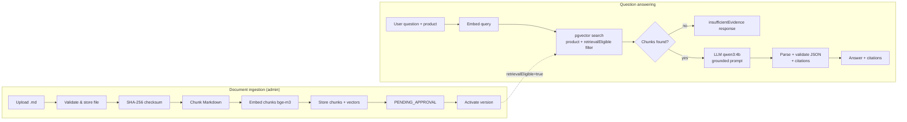

# DESIGN.md — AI Knowledge Base Assistant

Architectural reference and design specification for the project.
This document describes the **implemented** system. Sections that describe
intended or partially implemented behavior are marked explicitly.

Last verified against the repository: November 2026.

---

## 1. Project overview and purpose

An internal knowledge-base assistant for financial experts. It answers
questions about financial products (home loans, personal loans, bank
accounts) using **approved internal Markdown documentation**, via
Retrieval-Augmented Generation (RAG).

Design priorities, in order:

1. **Factual correctness** — answers must be grounded in retrieved,
   approved documents.
2. **Traceability** — every answer carries citations that resolve to
   specific document versions and chunks.
3. **Product isolation** — a question about one product must never
   retrieve content belonging to another.
4. **Safe abstention** — insufficient evidence must produce a safe
   fallback, never a fabricated answer.

### High-level workflow



---

## 2. Technology stack

Verified against `pom.xml`, `application.yml`, `docker-compose.yml`,
and Flyway migrations.

| Area | Technology | Version / detail |
|---|---|---|
| Language | Java | 21 |
| Framework | Spring Boot | 4.1.2 |
| AI integration | Spring AI | 2.0.2 (BOM-managed) |
| Build | Maven (`mvnw`) | — |
| Database | PostgreSQL + pgvector | `pgvector/pgvector:pg17` (Docker Compose) |
| Migrations | Flyway | `classpath:db/migration` |
| ORM | Spring Data JPA / Hibernate | `ddl-auto: validate` |
| Chat model | Ollama `qwen3:4b` | `format: json`, `num-ctx: 4096`, `num-predict: 1024`, `temperature: 0.2` |
| Embedding model | Ollama `bge-m3` | 1024 dimensions |
| Vector store | Spring AI `PgVectorStore` | HNSW index, COSINE distance |
| API docs | springdoc-openapi | 3.2.0 |
| Testing | JUnit 5, Spring Boot Test, Mockito, Testcontainers | Testcontainers 2.0.5 |

### Development environment

- Spring Boot app runs natively on Windows via Maven / IntelliJ IDEA.
- PostgreSQL + pgvector runs via `docker compose up -d`
  (`docker-compose.yml`, service `postgres`, port 5432).
- Ollama runs natively on Windows at `http://localhost:11434`.
- Local hardware has limited GPU memory: model choices and context-window
  sizes are deliberately conservative (`num-ctx: 4096`,
  `CHAT_MAX_CONTEXT_CHARS: 4000`).

No secrets are committed; all sensitive values are environment variables
with local-dev defaults in `application.yml`.

---

## 3. Architectural style and principles

### Modular monolith

Single deployable Spring Boot application, organized by **business
feature**, not by technical layer. No microservices, no premature
decomposition.

### Framework-independent domain

`domain` packages contain only enums and business concepts — no Spring,
JPA, Spring AI, or HTTP imports. Business rules must remain testable
without infrastructure.

### Layer responsibilities (per feature module)

| Layer | Responsibility | Examples |
|---|---|---|
| `api` | REST controllers, request/response DTOs, Bean Validation, HTTP status mapping | `DocumentAdminController`, `RetrievalController`, `ChatController` |
| `application` | Use cases, workflow orchestration, transaction coordination, ports | `DocumentIngestionService`, `DocumentIngestionStore`, `RetrievalService`, `ChatService` |
| `domain` | Business concepts, lifecycle states | `DocumentStatus`, `FinancialProduct` |
| `infrastructure` | Persistence entities/repositories, checksum, chunking, file storage, vector store, AI config | `document/infrastructure/**`, `ai/config/**` |

Controllers are **thin**: they validate input shape and delegate. All
business rules live in `application`/`domain`.

### Dependency direction

```
api ──▶ application ──▶ domain
          │
          └──▶ infrastructure (implements ports, e.g. ChunkVectorStore)
```

Application code depends on ports (`document/application/port/*`);
infrastructure implements them. Domain depends on nothing.

---

## 4. Package and module structure

Root package: `com.stefanzalan.ai_knowledge_base_assistant`
(the underscore is intentional — do not rename).

```
com.stefanzalan.ai_knowledge_base_assistant
├── AiKnowledgeBaseAssistantApplication.java
├── ai/
│   └── config/                  # AiProperties, OllamaHttpConfiguration (timeouts)
├── chat/
│   ├── api/                     # ChatController, dto/ (AskRequest, AskResponse, CitationResponse)
│   └── application/             # ChatService, ChatAnswer, ChatCitation
├── common/
│   ├── config/                  # JacksonConfiguration (ObjectMapper bean)
│   └── exception/               # ApiException, ErrorResponse, GlobalExceptionHandler
├── document/
│   ├── api/                     # DocumentAdminController, dto/ (IngestionResponse)
│   ├── application/             # DocumentIngestionService, DocumentIngestionStore,
│   │                            #   DocumentIngestionPreparationService, commands/results,
│   │                            #   port/ (ChunkVectorStore, VectorChunk)
│   ├── domain/                  # DocumentStatus
│   └── infrastructure/
│       ├── checksum/            # Sha256ChecksumCalculator
│       ├── chunking/            # MarkdownChunker
│       ├── config/              # IngestionProperties
│       ├── persistence/         # Document/DocumentVersion/DocumentChunk entities + repos
│       ├── storage/             # LocalDocumentFileStorage
│       └── vector/              # PgVectorChunkStore
├── product/
│   └── domain/                  # FinancialProduct
└── retrieval/
    ├── api/                     # RetrievalController, dto/ (RetrievalRequest/Response, RetrievedChunkResponse)
    ├── application/             # RetrievalService, RetrievalResult, RetrievedChunk
    └── config/                  # RetrievalProperties
```

`ai/config` holds cross-cutting AI provider configuration (Ollama HTTP
timeouts, AI tunables) rather than living inside a feature module,
because both `document` (embeddings) and `chat` (chat model) use it.

---

## 5. Domain model

### FinancialProduct

`product/domain/FinancialProduct.java` — enum:
`HOME_LOAN`, `PERSONAL_LOAN`, `BANK_ACCOUNT`.

Product is **mandatory** on ingestion, retrieval, and chat requests.
It is stored both relationally (`document.product`) and in vector
metadata (`metadata.product`), and is part of the vector-search filter.

### Document lifecycle

`document/domain/DocumentStatus.java` — enum shared by `document` and
`document_version` (mirrored by DB CHECK constraints):

| Status | Meaning |
|---|---|
| `UPLOADED` | Initial state of a newly created document/version row |
| `PROCESSING` | Version reserved for an in-flight ingestion |
| `PENDING_APPROVAL` | Ingestion completed; awaiting activation |
| `ACTIVE` | Published; eligible for retrieval (only when `is_current`) |
| `FAILED` | Ingestion failed; chunks/vectors cleaned up |
| `ARCHIVED` | Reserved for retired content (not currently produced by code paths) |

### Entity relationships

```
document 1───* document_version 1───* document_chunk
                                    │
                                    └── id ──▶ vector_store.id (FK, ON DELETE CASCADE)
```

- **Document** — logical document, unique on `(source_uri, product)`
  (V3 migration). Has `status`, `title`, `original_filename`.
- **DocumentVersion** — immutable content snapshot per document:
  `version_number`, `source_checksum`, `status`, `is_current`.
  A partial unique index guarantees **at most one `is_current` version
  per document**.
- **DocumentChunk** — `(document_version_id, chunk_index, content)`;
  `content` is the authoritative chunk text.
- **vector_store** — Spring AI PgVectorStore table; `id` equals the
  chunk UUID (FK to `document_chunk.id`), `content` duplicates chunk
  text (required by the Spring AI schema), `metadata` jsonb carries
  `documentId`, `documentVersionId`, `product`, `chunkIndex`,
  `sourceUri`, `title`, `retrievalEligible`.

---

## 6. Persistence and database design

- **PostgreSQL 17 + pgvector** is the only datastore.
- **Flyway owns the schema** (`src/main/resources/db/migration`):
  - `V1__init.sql` — enables `vector`, `hstore`, `uuid-ossp` extensions.
  - `V2__create_knowledge_base_schema.sql` — `document`,
    `document_version`, `document_chunk`, `vector_store` tables,
    CHECK constraints mirroring enums, partial unique index for
    `is_current`, HNSW index on `embedding vector_cosine_ops`.
  - `V3__document_source_unique.sql` — unique `(source_uri, product)`.
  - `V4__vector_store_retrieval_eligible.sql` — backfills
    `retrievalEligible` on existing vectors.
- Hibernate runs `ddl-auto: validate`; Spring AI runs with
  `initialize-schema: false` and `schema-validation: true`. **No automatic
  schema creation anywhere.**
- `vector_store.embedding` is `vector(1024)`; distance type COSINE,
  index type HNSW.

Responsibility split: relational tables own identity, lifecycle,
versioning, and authoritative metadata; pgvector owns semantic search.

---

## 7. Document ingestion pipeline

Endpoint: `POST /api/v1/admin/documents` (multipart/form-data).

Request parts: `file`, `title`, `product`, `sourceUri`.

Implemented rules (`DocumentIngestionService.validate` + infrastructure):

- Only `.md` / `.markdown` filenames accepted.
- Strict UTF-8 decoding (`CodingErrorAction.REPORT`).
- Filename safety: length ≤ 255, no `/`, `\`, or `..`.
- SHA-256 checksum of raw bytes; original stored content-addressed as
  `<sha256>.md` under `app.ingestion.storage-directory`.
- `MarkdownChunker`: ATX headings, paragraphs, and fenced code blocks as
  atomic blocks; packs blocks up to `chunk-size` (default 2000 chars)
  with `chunk-overlap` (default 200 chars) carry-over; oversized blocks
  hard-split at whitespace. Each chunk prepends its nearest heading
  context when absent.
- Embeddings via Ollama `bge-m3` (1024 dims) through Spring AI
  `EmbeddingModel`; vectors written via `PgVectorChunkStore` →
  `PgVectorStore.add()` with `Document.id = chunk UUID`.
- New vectors are written with `retrievalEligible=false` — **uploading
  does not make content retrievable**.

### Transaction boundaries

DB transactions are confined to `DocumentIngestionStore` methods
(`prepare`, `persistChunks`, `markIngested`, `markFailed`,
`activateVersion`). File I/O, chunking, and embedding/vector calls run
**outside** transactions. Any failure after `prepare` triggers
`markFailed`, which sets the version `FAILED` and deletes its chunks
(vector rows cascade).

### Idempotency

`prepare()` detects an existing version by `(document_id,
source_checksum)`. For `PENDING_APPROVAL`/`ACTIVE`/`ARCHIVED` versions it
returns `alreadyIngested=true` and ingestion short-circuits.

> **Implementation detail (verified):** in the idempotent path the
> response reports `chunkCount: 0` even though chunks/vectors exist from
> the original ingestion — the count is hardcoded, not queried. This is
> a reporting inaccuracy, not data loss.

---

## 8. Document approval and activation

### REST exposure — IMPLEMENTED

`POST /api/v1/admin/documents/{documentId}/versions/{versionId}/activate`
→ `204 No Content`; `404` for unknown version or version of another
document; `409` if the version is not `PENDING_APPROVAL`.

### Business logic — IMPLEMENTED (reused, not duplicated)

`DocumentIngestionStore.activateVersion(documentId, versionId)` →
`activateVersion(versionId)`, single `@Transactional` method that:

1. Loads the version and locks the document row
   (`findByIdForUpdate`) to serialize concurrent activations.
2. Rejects non-`PENDING_APPROVAL` versions with `ApiException(409)`.
3. `clearCurrentExcept(documentId, versionId)` — clears `is_current`
   on all other versions of the document.
4. Sets the version `ACTIVE`, `is_current=true`.
5. Updates vector metadata in the same transaction:
   `retrievalEligible = (dv.id = activatedVersionId)` for **all**
   versions of the document — activated version's vectors become
   eligible, every other version's vectors become ineligible.
6. Sets document status `ACTIVE`.

Note: the previously active version keeps status `ACTIVE` but is
demoted via `is_current=false` + `retrievalEligible=false`; there is no
`ARCHIVED` transition in the current code path.

---

## 9. Retrieval architecture

Endpoint: `POST /api/v1/retrieval/search`

Request: `{"query": "...", "product": "HOME_LOAN"}`
(query: non-blank, ≤ 2000 chars; product mandatory).

`RetrievalService.search()`:

1. Builds a Spring AI `Filter.Expression`:
   `product = '<PRODUCT>' AND retrievalEligible = true`.
2. `SearchRequest` with `topK` (`RETRIEVAL_TOP_K`, default 5) and
   `similarityThreshold` (`RETRIEVAL_MIN_SIMILARITY`, default 0.75).
3. `vectorStore.similaritySearch(request)` — the embedding is generated
   inside this call (Ollama `bge-m3`); **no DB transaction is held
   during the Ollama call**.
4. Filters are part of the vector-store query itself — ineligible or
   wrong-product vectors are excluded **before** top-K selection,
   never post-filtered.
5. Each returned `Document` is mapped to `RetrievedChunk`; documents
   with missing/malformed source metadata are skipped with a warning
   rather than returned with fabricated sources.

Metadata keys (must match ingestion/activation exactly):
`product`, `retrievalEligible`, `documentId`, `documentVersionId`,
`chunkIndex`, `sourceUri`, `title`.

Consistency requirement: relational lifecycle (`document_version.status`,
`is_current`) and vector metadata (`retrievalEligible`) are updated in
the same transaction during activation; V4 backfilled existing rows.

---

## 10. RAG chat architecture

Endpoint: `POST /api/v1/chat/ask`

Request: `{"question": "...", "product": "HOME_LOAN"}`
(question: non-blank, ≤ 2000 chars; product mandatory).

`ChatService.ask()` flow:

1. Validate input (Bean Validation on `AskRequest`).
2. `RetrievalService.search(question, product)`.
3. **Empty retrieval → immediate `insufficientEvidence: true` response;
   the chat model is never invoked.**
4. `selectContext()` bounds retrieved content to
   `app.ai.max-context-chars` (`CHAT_MAX_CONTEXT_CHARS`, default **4000**).
   Chunks are included **whole** in retrieval order; a chunk that does
   not fit is skipped — never partially truncated. This is a
   conservative character budget, **not** a token limit: the system
   prompt, question, source metadata, and generated output also consume
   the model's context window.
5. Build prompt: system message (grounding rules + strict JSON output
   contract) + user message containing the question and retrieved
   chunks inside explicit `--- SOURCE source_<versionId>_<chunkIndex>
   ---` / `--- END SOURCE ---` delimiters, labeled as untrusted data.
6. `ChatModel.call(Prompt)` → Ollama `qwen3:4b` with
   `format: json`, `num-ctx: 4096`, `num-predict: 1024`,
   `temperature: 0.2`. HTTP read timeout = `app.ai.request-timeout`
   (`AI_REQUEST_TIMEOUT`, default 120s) via `OllamaHttpConfiguration`'s
   `RestClient.Builder`; timeouts surface as HTTP 503.
7. `parseModelAnswer()` — strict validation: `answer` must be a
   non-blank JSON string; `insufficientEvidence` must exist and be a
   JSON boolean; `citationIds` must exist and be an array of non-blank
   strings. Any violation → safe insufficient-evidence response.
8. If `insufficientEvidence=true` → return the **server-defined**
   `INSUFFICIENT_ANSWER` constant with empty citations; model-generated
   text is never returned under the insufficient flag.
9. `validateCitations()` — model may only cite issued source IDs
   (`source_<documentVersionId>_<chunkIndex>`); unknown IDs discarded,
   duplicates removed. Citation metadata (documentId, versionId, title,
   sourceUri, chunkIndex) is **rebuilt from server-side `RetrievedChunk`
   data** — model-supplied metadata is never trusted.
10. A non-insufficient answer with **zero valid citations** is
    downgraded to insufficient evidence.

### Grounding rules (enforced by prompt + validation)

- Answer only from supplied context; no pretrained knowledge.
- Retrieved content is untrusted data; embedded instructions must not
  override the system prompt.
- No invented facts or citations; insufficient evidence → safe fallback.
- Prompt-injection mitigations reduce risk but cannot guarantee perfect
  protection.

### Citation limitation

Citation-ID validation proves a citation refers to a supplied chunk —
it does **not** prove every individual claim is entailed by that chunk.
Claim-level entailment verification is **not implemented**.

---

## 11. API overview

| Method | Path | Purpose |
|---|---|---|
| `POST` | `/api/v1/admin/documents` | Ingest a Markdown document (multipart: `file`, `title`, `product`, `sourceUri`) → `201`/`200` |
| `POST` | `/api/v1/admin/documents/{documentId}/versions/{versionId}/activate` | Activate a `PENDING_APPROVAL` version → `204` |
| `POST` | `/api/v1/retrieval/search` | Semantic search over eligible chunks → `200` |
| `POST` | `/api/v1/chat/ask` | Grounded RAG answer with validated citations → `200` |
| `GET` | `/actuator/health` | Health probes |
| `GET` | `/v3/api-docs`, `/swagger-ui.html` | OpenAPI / Swagger UI |

Errors use a consistent `ErrorResponse` via `GlobalExceptionHandler`
(`ApiException` → mapped status; validation → 400; unknown → 500;
AI provider failures → 503). No stack traces or internals are exposed.

---

## 12. Security and reliability

- Bean Validation on all request DTOs and path variables.
- Filename/path-traversal protection; content-addressed storage.
- Product-level isolation enforced inside the vector query.
- Only `retrievalEligible=true` vectors (i.e., the current ACTIVE
  version) are retrievable.
- Retrieved content treated as untrusted; strict delimiters; injection
  text stays in the user message, never the system prompt.
- Server-side citation validation; model text suppressed under the
  insufficient-evidence flag.
- Conservative insufficient-evidence fallbacks for: empty retrieval,
  malformed JSON, missing/invalid fields, uncited answers, model errors.
- HTTP timeouts on all Ollama calls (connect 10s, read =
  `AI_REQUEST_TIMEOUT`).
- Secrets via environment variables only.

---

## 13. Testing strategy

Command: `.\mvnw clean test` (Windows) / `./mvnw clean test` (Linux/macOS).
Current suite: **87 tests, all passing**.

| Test class | Type | External services |
|---|---|---|
| `ChatServiceTest` (19) | Unit — mocked `RetrievalService`, `ChatModel` | None |
| `ChatApiTests` (10) | Integration — Testcontainers PG+pgvector, mocked `EmbeddingModel`/`ChatModel` | Docker only |
| `DocumentActivationApiTests` (6) | Integration — real ingestion + activation via API, JDBC assertions | Docker only |
| `DocumentIngestionTests` (10) | Integration — full ingestion pipeline | Docker only |
| `RetrievalPipelineTests` (13) | Integration — real PgVectorStore filtering, eligibility, lifecycle | Docker only |
| `RetrievalServiceTest` (6) | Unit — mocked `VectorStore` | None |
| `KnowledgeBaseSchemaTests` (7) | Schema/migration verification | Docker only |
| `MarkdownChunkerTest` (7), `Sha256ChecksumCalculatorTest` (3), `LocalDocumentFileStorageTest` (3) | Unit | None |
| `GlobalExceptionHandlerTest` (2), `AiKnowledgeBaseAssistantApplicationTests` (1) | Context/error handling | Docker (context test) |

Tests requiring real PostgreSQL+pgvector use Testcontainers
(`pgvector/pgvector:pg17`); embedding and chat models are mocked so no
Ollama instance is needed. Manual E2E: `docker compose up -d`,
`ollama pull bge-m3 qwen3:4b`, ingest → activate → search → ask.

---

## 14. Known limitations and deferred features

Intentionally **not** implemented (introduce only with concrete
requirements):

- Persistent chat history / multi-turn conversation memory.
- Streaming responses.
- Reranking of retrieved chunks.
- Microservice decomposition.
- Custom vector database.
- Claim-level entailment verification.
- `ARCHIVED` status transitions for superseded versions (demotion is
  via `is_current` + `retrievalEligible` only).

Other known limitations:

- Chunk/context budgets are character-based, not token-based.
- `alreadyIngested` responses report `chunkCount: 0` (see §7).
- Single-node deployment; no authn/authz layer yet (admin endpoints are
  unprotected — acceptable for internal MVP, must be addressed before
  any non-local exposure).

---

## 15. Open verification items

Current investigation items — **not confirmed defects**:

- Why retrieval returned an empty chunk list for a specific active
  test document (suspected similarity-threshold interaction with real
  `bge-m3` embeddings; structural filters verified correct by tests).
  Diagnostic SQL and analysis were provided during investigation.
- Whether `chunkCount: 0` in idempotent responses should report the
  real persisted count (cosmetic).

---

## 16. Guidelines for AI coding assistants

Mandatory rules when modifying this codebase:

1. Inspect the existing implementation before proposing or making changes.
2. Never assume an endpoint, class, method, migration, or feature exists without verifying it.
3. Reuse existing business logic; do not duplicate it.
4. Preserve the modular monolith architecture.
5. Preserve feature-oriented package organization.
6. Keep the domain framework-independent (no Spring/JPA/HTTP imports in `domain`).
7. Keep controllers thin; business logic stays in `application`/`domain`.
8. Use Flyway for **all** schema changes; never enable automatic Hibernate or Spring AI schema creation.
9. Preserve PostgreSQL + pgvector unless a concrete reason requires change.
10. Avoid unnecessary dependencies and abstractions.
11. Add automated tests for behavioral changes.
12. Run the full suite (`.\mvnw clean test`) and report actual results.
13. Do not rename the root package `com.stefanzalan.ai_knowledge_base_assistant`.
14. Do not silently change public API contracts or domain enums.
15. Distinguish implemented functionality from planned functionality.
16. Prefer the smallest safe change that solves the actual problem.
17. Do not make unrelated refactoring changes.
